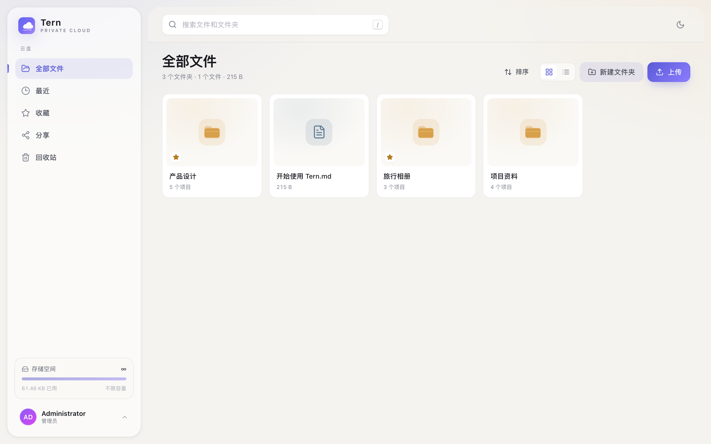
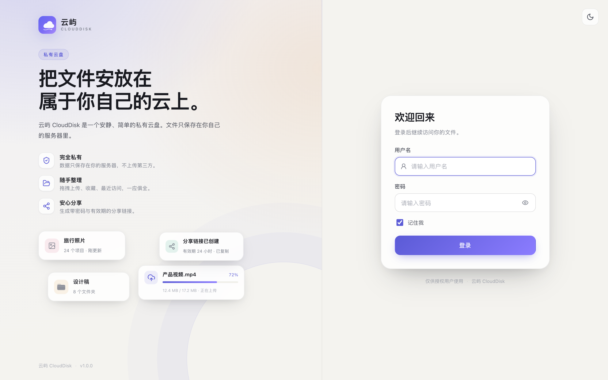
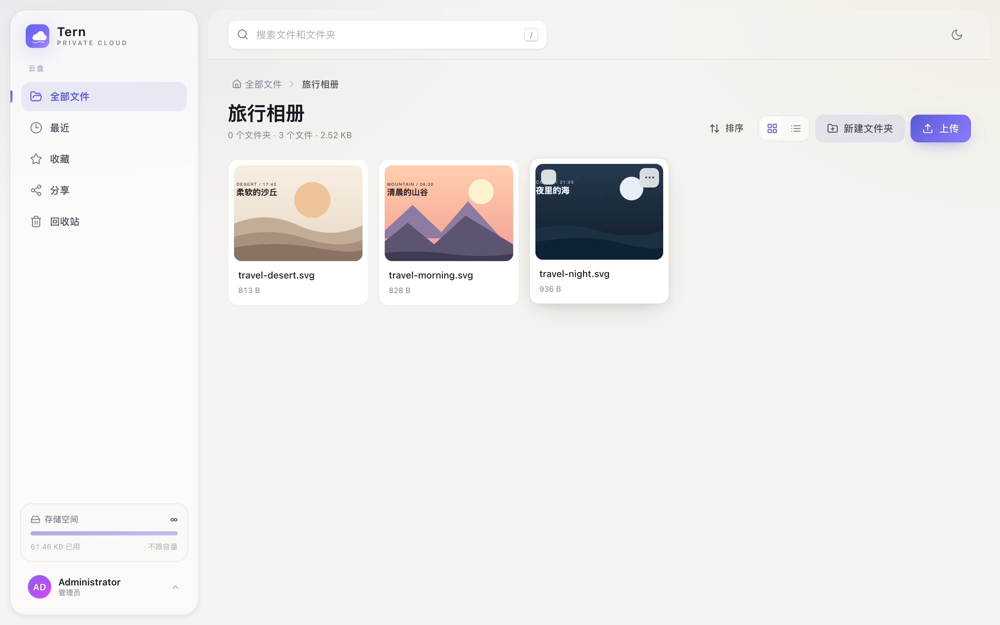
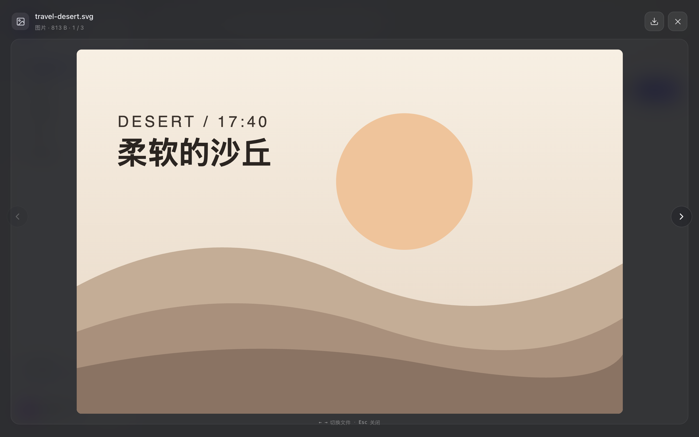
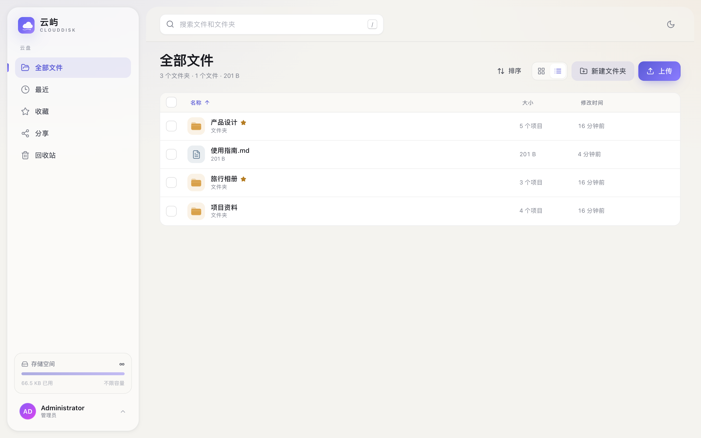
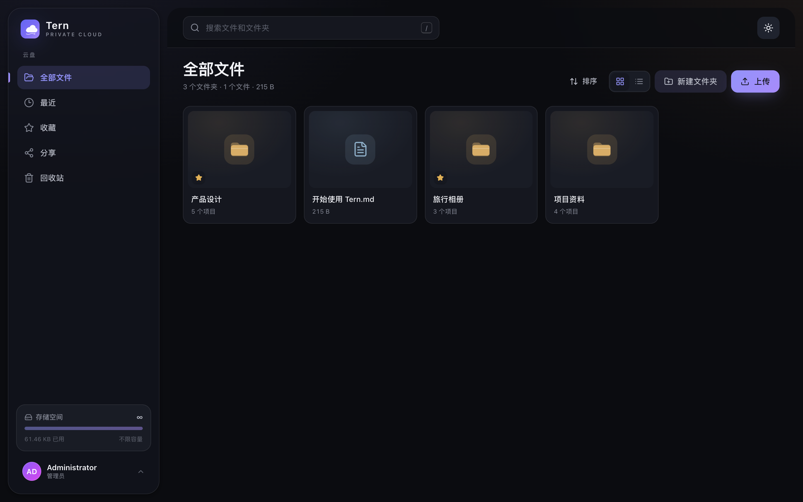
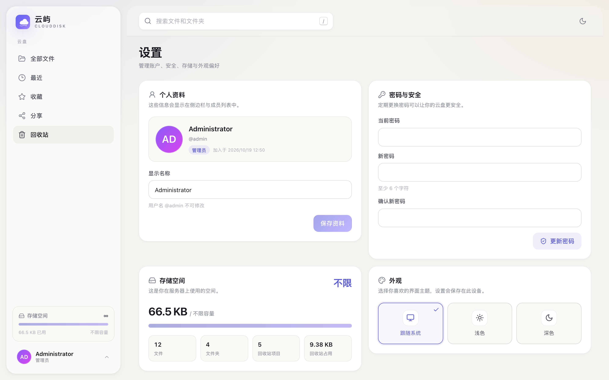
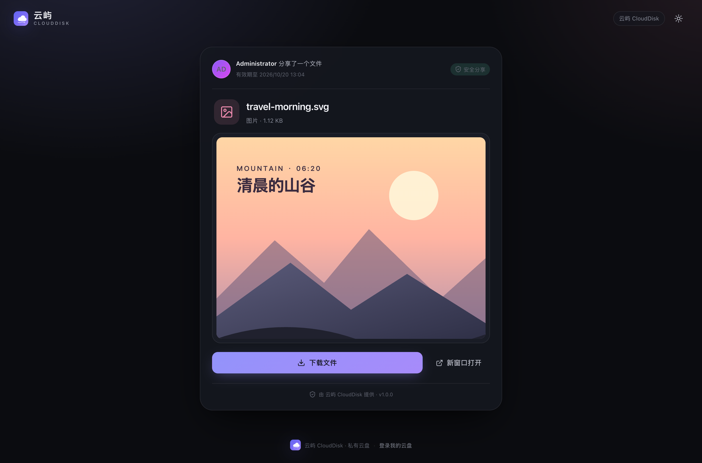
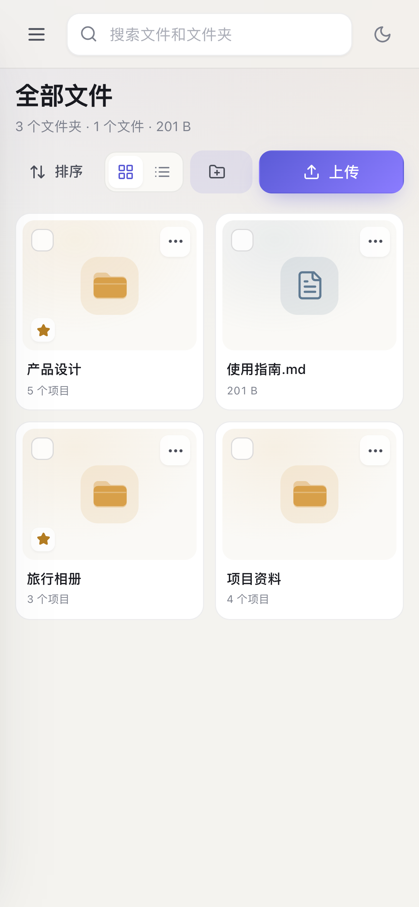
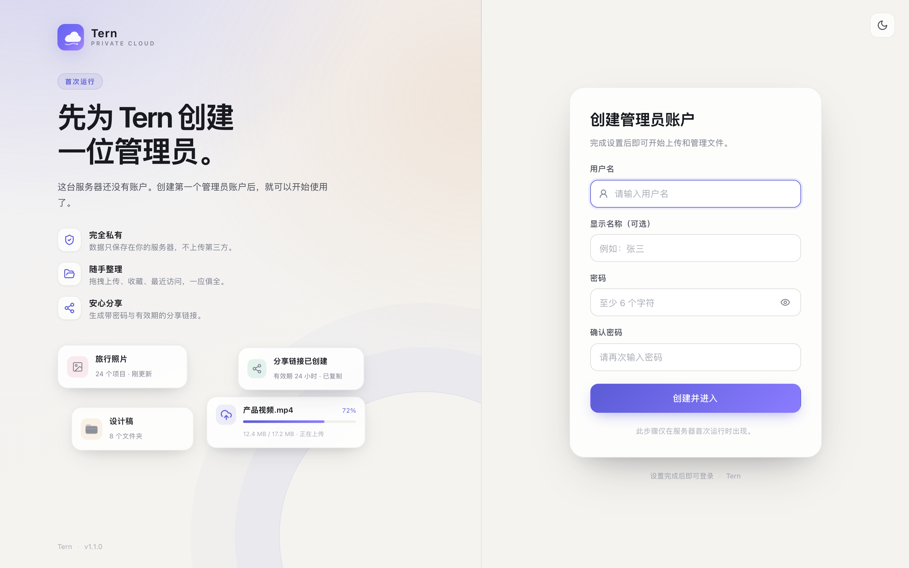

# Tern

[](https://github.com/XiaolongZhang-dev/tern/actions/workflows/ci.yml)
[](https://github.com/XiaolongZhang-dev/tern/actions/workflows/docker-publish.yml)
[](https://hub.docker.com/r/acc110789/tern)
[](LICENSE)
[](https://github.com/XiaolongZhang-dev/tern/releases)
[](https://github.com/XiaolongZhang-dev/tern/stargazers)

**English** | [简体中文](README.md)

A private cloud drive for your NAS: **one-command Docker deployment**, a clean
web UI, and a native macOS menu-bar client that mounts your files directly in
Finder — right next to iCloud Drive.

> Your data stays yours. Files live on your own NAS, never on a third-party cloud.
> Tern is open source under the MIT license.



## Features

- **Web app**: file and folder management, drag-and-drop uploads with progress,
  grid/list views, and previews for images, video, audio, PDF and text.
- **Organize**: search, recent, favorites, multi-select, bulk download/delete,
  move and rename.
- **Sharing**: public links with optional password and expiry; files and folders
  (folders download as ZIP).
- **Trash**: soft delete with restore, permanent delete and empty-trash actions.
- **Multi-user**: admin-created members with per-user storage quotas and isolated
  file trees.
- **WebDAV**: `/dav` and `/Tern` endpoints usable by Finder, Windows Explorer,
  rclone and any WebDAV client.
- **macOS client**: a menu-bar app that mounts the drive as a real network volume,
  visible in Finder's **Locations** sidebar, with optional auto-connect at login.
- **Docker**: a single container with SQLite + local file storage, x86_64/arm64
  support, non-root execution and NAS-friendly PUID/PGID.

## Screenshots

| Sign in | Files |
|---|---|
|  |  |

| Albums and thumbnails | Image preview |
|---|---|
|  |  |

| List view | Dark mode |
|---|---|
|  |  |

| Settings and members | Public share |
|---|---|
|  |  |

Mobile is supported too: the sidebar becomes a drawer and the toolbar adapts.

<p align="center">
  
</p>

## Quick start (Docker source build)

```bash
# 1. Enter the project directory
cd tern

# 2. Create your configuration
cp .env.example .env
# Edit .env: at minimum set ADMIN_PASSWORD;
# on a NAS, run `id` and set DATA_UID / DATA_GID

# 3. Build and start (the web app is built inside the image)
docker compose up -d --build
```

Open `http://<NAS-IP>:8080`:

- if `ADMIN_USERNAME` / `ADMIN_PASSWORD` are set in `.env`, the administrator is
  created automatically on first boot;
- otherwise the first-run setup page asks you to create the first admin account.



Data is stored in `./data` (SQLite database + file blobs) and survives container
upgrades. Back up the whole `data/` directory.

> Verified in Docker with multi-stage builds, non-root execution
> (`DATA_UID=501`), healthchecks, the SPA, login and WebDAV. See
> [docs/DEPLOY.md](docs/DEPLOY.md) for NAS-specific notes.

## Pull the Docker Hub image (no build)

Pushing a `v*` tag triggers GitHub Actions to build and publish a multi-arch image
to Docker Hub (`linux/amd64` + `linux/arm64`). The image contains the web app,
REST API and WebDAV, so no Node.js or local build is needed on the NAS.

The image is published on Docker Hub: **[acc110789/tern](https://hub.docker.com/r/acc110789/tern)**.

```bash
docker pull acc110789/tern:latest
mkdir -p data

docker run -d --name tern --restart unless-stopped \
  -p 8080:8080 \
  -v "$PWD/data:/data" \
  -e ADMIN_USERNAME=admin \
  -e ADMIN_PASSWORD='change-me' \
  -e DATA_UID="$(id -u)" \
  -e DATA_GID="$(id -g)" \
  acc110789/tern:latest
```

Open `http://<NAS-IP>:8080`. Reverse-proxy and upload settings are the same as
the source-build deployment.

Or use the dedicated Compose file:

```bash
cp .env.example .env
# Edit ADMIN_PASSWORD, DATA_UID and DATA_GID

docker compose -f docker-compose.hub.yml pull
docker compose -f docker-compose.hub.yml up -d
```

| Tag | Description |
|---|---|
| `latest` | Latest stable release |
| `1.1.1` / `1.1` / `1` | Semantic-version tags |
| `edge` | Manual `workflow_dispatch` test build |

> Maintainers: add `DOCKERHUB_USERNAME` and `DOCKERHUB_TOKEN` under
> **Settings → Secrets and variables → Actions**, then run
> [Docker Publish](https://github.com/XiaolongZhang-dev/tern/actions/workflows/docker-publish.yml)
> once (publishes `latest` + `edge`) or push a new `v*` tag. The Docker Hub token
> needs Read & Write permission.

## macOS client (Finder mount)

The client uses macOS `NetFS` to mount the server's WebDAV endpoint as a real
network volume. It appears in Finder's **Locations** sidebar next to iCloud Drive
and supports read/write, drag-and-drop and Quick Look — no Apple Developer
account required.

**Option A: use the prebuilt app (Apple Silicon / arm64)**

Download
[`macos/dist/Tern-1.1.1.zip`](macos/dist/Tern-1.1.1.zip) (or from
[Releases](https://github.com/XiaolongZhang-dev/tern/releases)) and move
`Tern.app` to `/Applications`. Verify the download:

```bash
cd macos/dist && shasum -a 256 -c Tern-1.1.1.zip.sha256
```

If Gatekeeper blocks the app, right-click → **Open**, or run:

```bash
xattr -dr com.apple.quarantine /Applications/Tern.app
```

> The prebuilt bundle is arm64. On Intel Macs, build from source with
> `cd macos && ARCHS=x86_64 ./build.sh`.

**Option B: build from source**

```bash
cd macos
./build.sh
open dist/Tern.app
```

First launch:

1. Click the cloud icon in the menu bar → **Settings**.
2. Enter the server URL, for example
   `http://192.168.1.10:8080/Tern` (local default:
   `http://127.0.0.1:8080/Tern`).
3. Enter the same username and password as the web app, then click **Connect**.
4. Finder's **Locations** sidebar now shows **Tern**. Drag it to **Favorites** to
   keep it pinned.
5. Optionally enable **Launch at login** and **Connect automatically**.

Verify the mount stack from a terminal:

```bash
macos/tools/mount-smoke --url http://127.0.0.1:8080/Tern \
  --user admin --password 'your-password'
# RESULT: PASS (exit 0)
```

See [docs/MAC.md](docs/MAC.md) for Gatekeeper, Keychain, login items, HTTPS,
uninstall and troubleshooting details.

## Documentation

- [docs/DEPLOY.md](docs/DEPLOY.md) — Synology / QNAP / Unraid, HTTPS reverse
  proxy, backups, upgrades and troubleshooting
- [docs/MAC.md](docs/MAC.md) — macOS build, install, Finder integration and
  uninstall
- [docs/ARCHITECTURE.md](docs/ARCHITECTURE.md) — architecture and security model
- [docs/API.md](docs/API.md) — REST / WebDAV API contract
- [ROADMAP.md](ROADMAP.md) — known limitations and planned work
- [CONTRIBUTING.md](CONTRIBUTING.md) — development setup, tests and contribution
  guidelines
- [CHANGELOG.md](CHANGELOG.md) — release history
- [SECURITY.md](SECURITY.md) — security model and vulnerability reporting

## Architecture

```
Browser (React SPA) ──┐
                      ├── HTTP :8080 ── Node.js (Express) ── SQLite (metadata)
macOS Finder ──WebDAV─┘                     │
                                            └── data/storage/<user>/<uuid> (blobs)
```

- One container serves the SPA, REST API and WebDAV; a reverse proxy only needs
  one upstream.
- Metadata lives in SQLite (WAL); file blobs are stored by UUID, so rename/move
  operations do not touch file contents.
- Passwords use scrypt hashing; session cookies are HttpOnly; share passwords are
  optional and can expire.
- WebDAV implements `PROPFIND`, `LOCK`/`UNLOCK`, `MOVE`, Range `GET` and the other
  methods Finder needs for read-write mounts.

## Local development

```bash
# Terminal 1: backend (Node 24+)
cd server
npm install
PORT=18080 DATA_DIR=./.data ADMIN_USERNAME=admin ADMIN_PASSWORD=tern123 npm run dev

# Terminal 2: web client (Vite proxies to :18080)
cd web
npm install
npm run dev
```

Open `http://127.0.0.1:5173`. Production build: `cd web && npm run build`; the
Node server serves `web/dist` automatically.

### Tests

```bash
cd server && npm test      # 35 integration tests: auth, files, shares, WebDAV
cd web && npm run build    # TypeScript + production build
cd macos && ./build.sh     # menu-bar app + mount CLI (macOS only)
```

The server suite covers uploads/downloads, Range requests, move/copy, trash,
quotas, share passwords, WebDAV locks and read/write mounts. macOS mounting has
been verified in a real Finder session: mount → list → write → read → delete →
unmount.

## Requirements

- Server: Docker / Docker Compose, or Node.js 24+
- macOS client: macOS 13+ (Apple Silicon or Intel); building from source requires
  Xcode Command Line Tools
- Browser: recent versions of Chrome, Edge, Safari or Firefox

## Security

- Use HTTPS behind a reverse proxy when exposing Tern outside a trusted LAN, and
  set a strong password.
- WebDAV uses HTTP Basic authentication; do not expose plain HTTP to untrusted
  networks.
- Keep `data/` on a RAID/snapshot volume and back it up regularly.

## Contributing

Tern is an open-source project and contributions are welcome:

- Read [CONTRIBUTING.md](CONTRIBUTING.md) and
  [CODE_OF_CONDUCT.md](CODE_OF_CONDUCT.md).
- Use [Issues](https://github.com/XiaolongZhang-dev/tern/issues) for bugs and
  feature requests.
- Report security issues privately following [SECURITY.md](SECURITY.md); do not
  open a public issue.
- Not sure where to start? Check [ROADMAP.md](ROADMAP.md) or issues labelled
  `good first issue`.

If you find Tern useful, a star is appreciated.

## License

[MIT](LICENSE) © 2026 Tern contributors

Third-party dependencies keep their own licenses. The macOS client uses Apple
system frameworks; follow Apple's terms when distributing builds.
