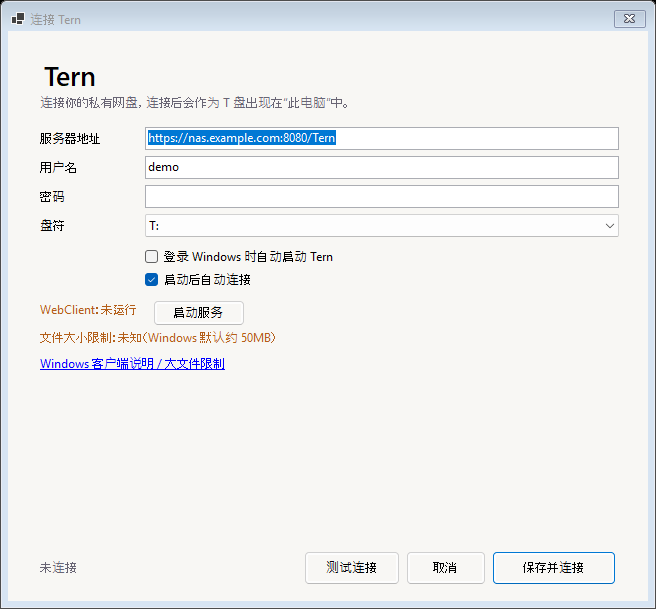

# Windows 客户端（Tern for Windows）



Tern for Windows 是一个托盘应用。它把 Tern 服务端的 WebDAV 端点映射为本地盘符，
所以在「此电脑」里看到的不是一个网页，而是：

```text
Tern (T:)
```

可以像网络盘一样复制、粘贴、拖拽、打开文件；Office/WPS 也可以直接打开并保存。

> 这是 **WebDAV 网络盘**，不是离线同步盘。服务器不可用时 T 盘不可用；如果需要离线缓存，
> 后续应改用 WinFsp / Cloud Files 方案。

## 1. 安装

从 Releases 下载 `Tern-Windows-Setup.exe` 安装（推荐），或下载 `Tern-Windows-x64.zip` 解压后运行 `Tern.exe`。

当前构建未做代码签名，Windows SmartScreen 可能提示「Windows 已保护你的电脑」。
选择「更多信息 → 仍要运行」即可。

如果设置页显示 **WebClient：未运行**，点击右侧的 **启动服务**，Windows 会弹出 UAC 提示；启动后再点「保存并连接」。

## 2. 第一次连接

1. 右键任务栏托盘区域的 Tern 图标 → **设置**；
2. 填写：
   - **服务器地址**：`https://<NAS-IP>:8080/Tern`（局域网可用 `http://`，但建议 HTTPS）
   - **用户名 / 密码**：与网页端相同
   - **盘符**：默认 `T:`，可换其他空闲盘符
3. 点 **测试连接**；
4. 点 **保存并连接**；
5. 打开「此电脑」，应看到 `Tern (T:)`。

如果连接成功，可以把 `Tern (T:)` 固定到「快速访问」。

## 3. 托盘菜单

```text
Tern
────────────────
已连接 · T: · 在线
在资源管理器中打开
断开连接 / 连接
设置…
打开日志
退出 Tern
```

- **登录时自动启动**：写入当前用户的 `HKCU\Software\Microsoft\Windows\CurrentVersion\Run`
- **启动后自动连接**：启动时用保存的凭据重新映射
- 密码保存在 **Windows 凭据管理器**，不会写到配置文件

## 4. 前置条件：WebClient 服务

Windows 的 WebDAV 重定向器依赖 **WebClient** 服务：

1. 按 `Win + R`，输入 `services.msc`；
2. 找到 **WebClient**；
3. 启动服务，启动类型建议设为「手动」或「自动」。

管理员命令行也可以：

```powershell
sc start WebClient
```

如果设置页显示「WebClient 服务：未运行」，先启动它再连接。

## 5. 大文件限制

Windows WebDAV 默认只允许约 **50MB** 的单个文件。需要传输更大文件时，
以管理员身份修改注册表并重启 WebClient：

```powershell
reg add "HKLM\SYSTEM\CurrentControlSet\Services\WebClient\Parameters" /v FileSizeLimitInBytes /t REG_DWORD /d 4294967295 /f
sc stop WebClient
sc start WebClient
```

> `4294967295` 表示不限制；也可以设置成需要的字节数。修改系统注册表前请自行评估风险。

## 6. HTTPS 与证书

Windows WebDAV 推荐使用 HTTPS：

- Let's Encrypt 等公共证书通常可直接使用；
- 自签名证书需要先在「证书管理器」中导入并信任；
- 如果提示 `1200`、证书错误或无法访问，先检查证书信任链。

公网访问不要直接暴露明文 HTTP。

## 7. 常见错误

| 错误码 / 现象 | 处理 |
|---|---|
| `1200` | WebClient 服务未运行，或 HTTPS 证书不受信任 |
| `67` | 服务器路径不对，确认地址是 `/Tern` |
| `1326` / `86` | 用户名或密码错误 |
| `53` | 网络不通、地址或端口错误 |
| `1219` | 该账号已有冲突的网络凭据，断开其他映射后重试 |
| 盘符不可用 | 在设置里换一个空闲盘符 |
| 能登录网页但客户端失败 | 检查 WebClient 服务、HTTPS 证书和 `/Tern` 路径 |

日志位置：

```text
%LOCALAPPDATA%\Tern\Tern.log
```

## 8. 卸载

**安装版：** 设置 → 应用 → Tern → 卸载。卸载程序会删除程序目录、`%LOCALAPPDATA%\Tern` 和开始菜单项，同时清理开机启动注册表项。

**便携版：**

1. 托盘菜单 → **退出 Tern**；
2. 删除 `Tern.exe` 所在文件夹；
3. 删除 `%LOCALAPPDATA%\Tern`；
4. 如启用了开机启动，删除注册表值：

```powershell
reg delete "HKCU\Software\Microsoft\Windows\CurrentVersion\Run" /v Tern /f
```

可选：在「凭据管理器 → Windows 凭据」中删除 `Tern:` 开头的条目。

## 9. 从源码构建

需要 .NET 8 SDK：

```powershell
cd windows
powershell -ExecutionPolicy Bypass -File .\build.ps1
```

生成 `windows\Tern-Windows-x64.zip`；安装 Inno Setup 6 后还会生成 `windows\Tern-Windows-Setup.exe`。

## 10. 已知限制

- 仅支持 Windows 10/11 x64；
- WebDAV 网络盘，无离线缓存；
- 首次映射依赖 WebClient 服务；
- 默认 50MB 单文件限制需要手动调整；
- 未签名构建，首次运行可能有 SmartScreen 提示。
